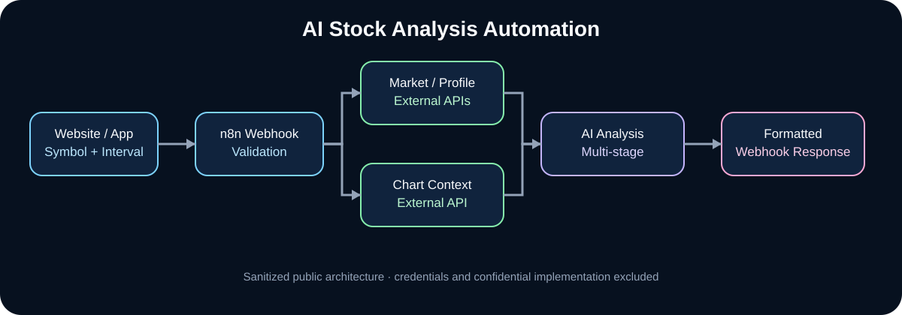

# N8N AI Stock Analysis Automation — Case Study

> OSYSTIC ENGINEERING CASE STUDY · PUBLIC SHOWCASE · SANITIZED · PORTFOLIO-SAFE

This repository documents a private automation engagement in which OSYSTIC designed an n8n workflow for AI-assisted stock-market analysis. The confidential implementation remains private. This public repository contains no client identity, credentials, private account data, commercial terms, raw workflow export, or proprietary deployment configuration.

## Company showcase classification

| Attribute | Public classification |
|---|---|
| Publisher | OSYSTIC |
| Artifact type | Engineering case study / capability proof |
| Source engagement | Private workflow automation delivery |
| Publication model | Sanitized public companion with independent Git history |
| Confidential source | Excluded and retained privately |
| Live-trading claim | None |
| Intended use | Portfolio, proposals, technical review, capability proof |

## What was engineered

The private system accepts a stock symbol and interval through a webhook-driven workflow, validates and normalizes the request, collects market and company context from external APIs, obtains chart context, runs multiple AI analysis stages, formats the result, and returns a structured response to a calling web application.

The retained private workflow contains 20 nodes and 19 connection groups, covering input validation, market-data acquisition, chart context, AI reasoning, technical-analysis extraction, formatting, memory and webhook response.

## Architecture

Website or application
  → n8n webhook
  → request validation and symbol normalization
  → market/profile APIs plus chart context
  → AI analysis stages
  → structured result formatting
  → webhook response

## Engineering highlights

- Webhook-first orchestration for browser/application integration.
- Symbol normalization and exchange-aware mapping before downstream requests.
- Parallel use of market/profile sources and chart context.
- Multiple AI stages for technical, fundamental and trading-oriented summarization.
- Structured response formatting for frontend consumption.
- Symbol-scoped memory for contextual analysis.
- Portable deployment boundary using n8n and Docker.
- Credential separation so secrets stay in the runtime credential store rather than Git.
- Repository hardening after legacy credential exposure was identified.

## Technology

n8n · Node.js · Docker · Webhooks · OpenAI-compatible nodes · REST APIs · market-data APIs · chart APIs · JavaScript/Python code nodes

## Validation boundary

The private canonical repository validates workflow structure, credential hygiene and repository safety. This public case study validates only the sanitized documentation boundary.

This showcase does not independently validate market-data accuracy, real-time execution latency, investment outcomes, live brokerage behavior, profitability, win rate, alpha, ROI or suitability for financial decision-making.

## Public vs private boundary

| Area | Public case study | Private canonical repository |
|---|---|---|
| Architecture | Sanitized | Detailed |
| Workflow source | Excluded | Retained |
| API credentials | Excluded | Runtime-only |
| Client identity | Excluded | Controlled |
| Commercial terms | Excluded | Controlled |
| Raw provider configuration | Excluded | Controlled |
| Portfolio-safe narrative | Included | Not intended for sharing |

## What is intentionally not claimed

- No guaranteed profitability or investment return.
- No claim of live brokerage order execution.
- No claim that AI output is financial advice.
- No claim that external market-data providers are complete or error-free.
- No claim that historical analysis predicts future performance.
- No claim that this public repository reproduces the confidential implementation.

## Read more

- Full case study: case-study.md
- Technical overview: docs/technical-overview.md
- Validation evidence: docs/validation-evidence.md
- Disclosure boundary: docs/disclosure-boundary.md
- Standardization acceptance: docs/standardization-acceptance.md
- Publication and reuse boundary: NOTICE.md
